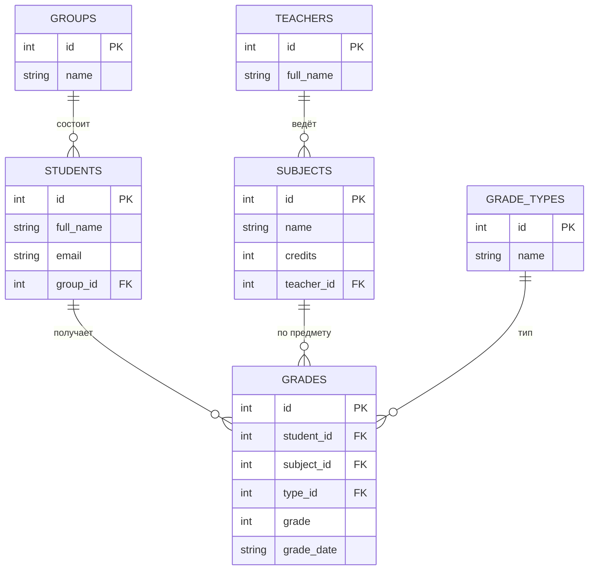
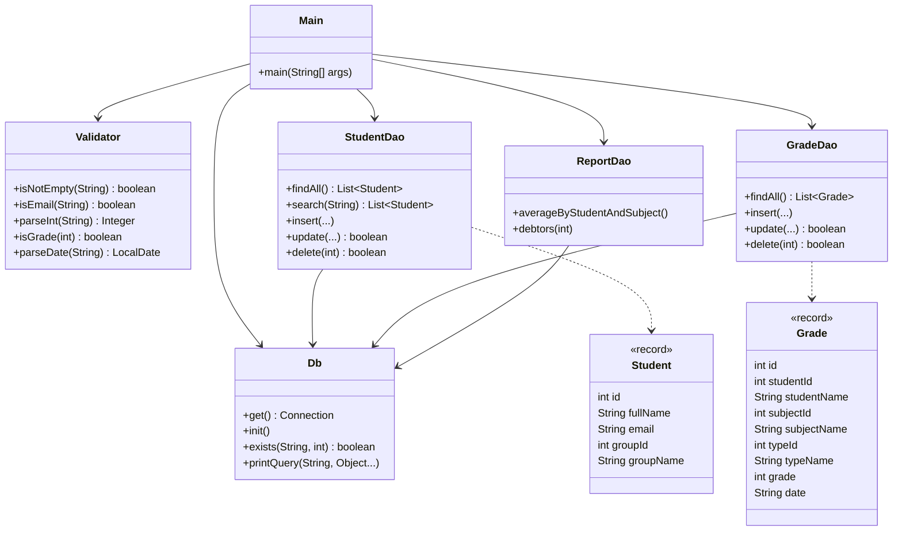

# Учёт студентов и оценок

Курсовой проект: консольное Java-приложение (JDBC + SQLite).

## Запуск
1. Открыть `pom.xml` в IntelliJ IDEA (File -> Open -> Open as Project).
2. Дождаться загрузки Maven-зависимостей (sqlite-jdbc).
3. Запустить класс `app.Main`. Файл БД `students.db` создаётся автоматически вместе с тестовыми данными.

Если кириллица в консоли отображается неверно: Run -> Edit Configurations -> VM options -> `-Dfile.encoding=UTF-8`.

## Возможности
- Полный CRUD: студенты, оценки
- Поиск студентов по имени, email, группе (`LIKE`)
- Отчёт 1: средний балл по студентам и предметам (JOIN 5 таблиц + COUNT / AVG / GROUP BY)
- Отчёт 2: должники со средним баллом ниже 50 (HAVING)
- Валидация: пустые поля, формат email, оценка 0-100, дата `yyyy-MM-dd`, существование ID, уникальный email

## Нормализация (3NF)
Группа, преподаватель, предмет и тип оценки вынесены в отдельные таблицы. В `grades` хранятся только внешние ключи и сама оценка, поэтому нет повторяющихся данных и транзитивных зависимостей.

## ER-диаграмма

## Class diagram

